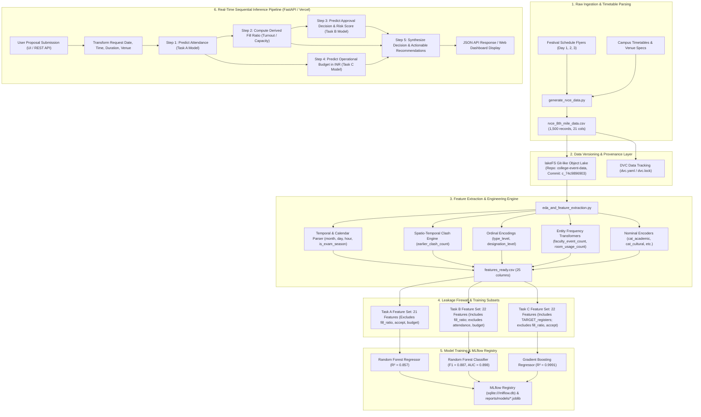
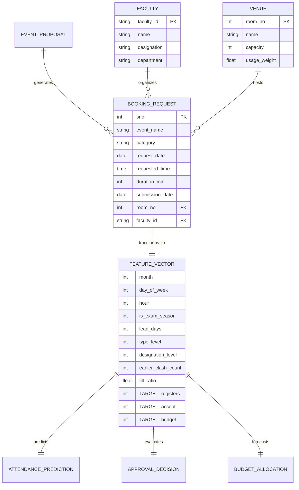

# 📐 System Data Flow & Schema Specification
## RVCE 8th Mile Intelligent Campus Event Management System

This document outlines the **End-to-End Data Flow Architecture** and **Formal Data Schemas** governing the RVCE 8th Mile event intelligence platform, spanning raw ingestion, versioning, feature engineering, leakage prevention firewalls, sequential model inference, and API serialization.

---

## 1. 🔄 End-to-End System Data Flow Architecture

The data flow connects raw festival schedules and campus timetables with triple-task machine learning inference and automated decision governance.



---

## 2. 📊 Detailed Stage-by-Stage Data Flow Description

| Stage | Process / Script | Primary Inputs | Output Artifacts | Transformation Logic & Invariants |
| :--- | :--- | :--- | :--- | :--- |
| **1. Data Generation** | [`generate_rvce_data.py`](file:///Users/aarav/event%20management/generate_rvce_data.py) | Festival flyer schedules (Days 1–3) + RVCE venue catalog | `rvce_8th_mile_data.csv`, `synthetic_event_data.csv` | 1,500 rows, 44 events, 22 venues; injects controlled 4.5% overcapacity and spatio-temporal clash candidates. |
| **2. Data Versioning** | [`lakefs_versioning.py`](file:///Users/aarav/event%20management/lakefs_versioning.py), `dvc.yaml` | Raw and processed CSVs | Commit `c_74c9896903` on branch `main` | Zero-copy branching, immutable SHA-tracked dataset snapshots. |
| **3. Feature Extraction** | [`eda_and_feature_extraction.py`](file:///Users/aarav/event%20management/eda_and_feature_extraction.py) | `rvce_8th_mile_data.csv` | `features_ready.csv` (25 cols) | Transforms date/time strings into cyclical features, calculates historical room usage frequencies, executes clash interval sweep. |
| **4. Leakage Firewall** | [`config.yaml`](file:///Users/aarav/event%20management/config.yaml), `train_*.py` | `features_ready.csv` | Isolated feature matrices ($X_A, X_B, X_C$) | Strict target isolation: attendance is predicted *before* approval and fill ratio exist. |
| **5. Model Registry** | [`app/registry.py`](file:///Users/aarav/event%20management/app/registry.py) | Trained estimators | `reports/models/*.joblib`, `reports/champion_metrics.json` | Versions models (`v1.0.0`), attaches test metrics, tags `@champion` status, pre-warms weights on startup. |
| **6. Inference Microservice** | [`app/services.py`](file:///Users/aarav/event%20management/app/services.py), [`app/main.py`](file:///Users/aarav/event%20management/app/main.py) | REST payload / UI inputs | `ComprehensiveEventDecisionResponse` | Derives feature vector $\rightarrow$ executes attendance regression $\rightarrow$ computes fill ratio $\rightarrow$ classifies approval $\rightarrow$ forecasts budget $\rightarrow$ triggers risk rules. |

---

## 3. 🛡️ Target Leakage Prevention Architecture

Data leakage between pre-event planning and post-event administrative evaluation is prevented via feature partitioning:

```
Full Feature Store (25 Columns in features_ready.csv)
 ├── 21 Pre-Event Requisition Features [SHARED]
 │    ├── Temporal: month, day_of_week, is_saturday, week_of_year, is_exam_season, hour, is_afternoon
 │    ├── Planning: duration_min, lead_days
 │    ├── Ordinal: type_level, designation_level
 │    ├── Spatial: room_no, room_capacity
 │    ├── Frequencies: faculty_event_count, room_usage_count, earlier_clash_count
 │    └── Categories: cat_academic, cat_cultural, cat_fun_club, cat_sports, cat_technical
 │
 ├── TARGET_registers (Actual Student Attendance) ───────────────► Target for Task A | Input to Task C
 ├── fill_ratio (Derived: Registers / Room_Capacity) ────────────► Input strictly for Task B
 ├── TARGET_accept (Administrative Booking Verdict) ─────────────► Target for Task B
 └── TARGET_budget (Operational Financial Budget in INR) ────────► Target for Task C
```

### Leakage Matrix

| Feature | Task A: Attendance | Task B: Approval | Task C: Budget |
| :--- | :---: | :---: | :---: |
| **21 Pre-Event Base Features** | ✅ Allowed | ✅ Allowed | ✅ Allowed |
| `TARGET_registers` | ❌ **TARGET VARIABLE** | ❌ **STRICTLY FORBIDDEN** | ✅ **ALLOWED INPUT** |
| `fill_ratio` | ❌ **STRICTLY FORBIDDEN** | ✅ **ALLOWED INPUT** | ❌ **STRICTLY FORBIDDEN** |
| `TARGET_accept` | ❌ **STRICTLY FORBIDDEN** | ❌ **TARGET VARIABLE** | ❌ **STRICTLY FORBIDDEN** |
| `TARGET_budget` | ❌ **STRICTLY FORBIDDEN** | ❌ **STRICTLY FORBIDDEN** | ❌ **TARGET VARIABLE** |

---

## 4. 📋 Formal Data Schemas

### Schema 1: Raw Transactional Booking Records (`rvce_8th_mile_data.csv`)

| Column Name | SQL / Pandas Type | Nullable | Example / Domain | Description |
| :--- | :--- | :---: | :--- | :--- |
| `SNO` | `INTEGER` | No | `1` to `1500` | Monotonically increasing record transaction index |
| `Event` | `VARCHAR(128)` | No | `"Kannada Habba"` | Name of official festival competition or workshop |
| `Event_Category` | `VARCHAR(32)` | No | `cultural`, `technical`, `academic`, `sports`, `fun_club` | Genre taxonomy classification |
| `Faculty_id` | `VARCHAR(16)` | No | `"RVCE_FAC0108"` | Unique organizer employee ID |
| `Faculty_name` | `VARCHAR(64)` | No | `"Dr. Mamatha G.S"` | Department faculty lead coordinating the request |
| `Faculty_Designation`| `VARCHAR(32)` | No | `Assistant Professor`, `Associate Professor`, `Professor` | Academic seniority level |
| `Registers` | `INTEGER` | No | `15` to `2020` | Student attendance registrations (Raw Target A) |
| `Type` | `VARCHAR(32)` | No | `Normal`, `Important`, `Very important` | Administrative festival priority level |
| `Request for Booking` | `INTEGER` | No | `1` | Binary flag indicating venue reservation request |
| `Request for Cancelling`| `INTEGER` | No | `0` | Binary cancellation flag (constant 0) |
| `Requested Room No` | `INTEGER` | No | `100` to `205` | RVCE campus venue identifier |
| `Requested Venue` | `VARCHAR(64)` | No | `"Main Stage"`, `"IEM Auditorium"` | Campus facility name |
| `Room_Capacity` | `INTEGER` | No | `60` to `1500` | Physical seating capacity limit |
| `Request Date` | `VARCHAR(16)` | No | `"06/15/2023"` (`%m/%d/%Y`) | Scheduled date of the event |
| `Request Submitted On`| `VARCHAR(16)` | No | `"06/02/2023"` (`%m/%d/%Y`) | Timestamp when organizer submitted application |
| `Requested Time` | `VARCHAR(16)` | No | `"9:00am"`, `"14:30"` | Event start time |
| `Duration` | `VARCHAR(16)` | No | `"60min"`, `"120min"` | Scheduled time window |
| `Room Available/Not Available` | `VARCHAR(32)` | No | `Available`, `Not Available` | Spatial conflict status |
| `Accept/Reject` | `VARCHAR(16)` | No | `Accept`, `Reject` | Final administrative booking verdict (Raw Target B) |
| `Reject_Reason` | `VARCHAR(64)` | Yes | `Room conflict`, `Capacity exceeded`, `Policy/other` | Explanation if rejected (empty if accepted) |
| `Budget` | `INTEGER` | No | `₹21,100` to `₹643,900` | Operational budget allocated in INR (Raw Target C) |

---

### Schema 2: Engineered Feature Store (`features_ready.csv`)

Total: **25 Columns**, all numerical (`int64` and `float64`), 0 missing values.

| # | Column Name | Type | Value Range | Derivation Logic & Operational Meaning |
| :---: | :--- | :--- | :---: | :--- |
| **1** | `month` | `int64` | `1 – 12` | Extracted from `Request Date`. Captures academic seasonal variations. |
| **2** | `day_of_week` | `int64` | `0 – 6` | `0 = Monday`, `6 = Sunday`. Day of week of scheduled event. |
| **3** | `is_saturday` | `int64` | `0, 1` | Binary indicator for Saturday festival main days. |
| **4** | `week_of_year` | `int64` | `1 – 53` | ISO calendar week number of event. |
| **5** | `is_exam_season` | `int64` | `0, 1` | `1` if month $\in \{4, 5, 11, 12\}$ (exam periods; turnout suppression). |
| **6** | `hour` | `int64` | `9 – 22` | 24-hour start time (e.g. `9 AM -> 9`, `8 PM -> 20`, `10 PM -> 22`). |
| **7** | `is_afternoon` | `int64` | `0, 1` | `1` if $\text{hour} \ge 14$ (post-2:00 PM post-lecture time window). |
| **8** | `duration_min` | `int64` | `60 – 720` | Parsed duration in minutes (`60, 90, 120, 180, 240, 720`). |
| **9** | `lead_days` | `int64` | `1 – 30` | Difference in days: $\text{Date}_{\text{event}} - \text{Date}_{\text{submit}}$. Promo lead time. |
| **10** | `type_level` | `int64` | `1 – 3` | Ordinal scale: `Normal = 1`, `Important = 2`, `Very important = 3`. |
| **11** | `designation_level`| `int64` | `1 – 3` | Ordinal scale: `Asst. Prof = 1`, `Assoc. Prof = 2`, `Professor = 3`. |
| **12** | `room_no` | `int64` | `100 – 205` | Categorical numerical room identifier. |
| **13** | `room_capacity` | `int64` | `60 – 1500` | Physical seating capacity of requested room. |
| **14** | `faculty_event_count`| `int64` | `1 – 150` | Total historical booking frequency of the organizing faculty lead. |
| **15** | `room_usage_count` | `int64` | `1 – 250` | Total historical booking count for this venue across festival records. |
| **16** | `earlier_clash_count`| `int64`| `0 – 5` | Number of chronologically prior overlapping requests for same room & date. |
| **17** | `cat_academic` | `int64` | `0, 1` | 1-hot flag for academic symposiums, paper presentations, debates. |
| **18** | `cat_cultural` | `int64` | `0, 1` | 1-hot flag for concerts, dance, music, fashion, theatre. |
| **19** | `cat_fun_club` | `int64` | `0, 1` | 1-hot flag for anime quizzes, photography, treasure hunts. |
| **20** | `cat_sports` | `int64` | `0, 1` | 1-hot flag for IPL auctions, stunt shows, obstacle endurance. |
| **21** | `cat_technical` | `int64` | `0, 1` | 1-hot flag for hackathons, gaming esports, drone flight, simulations. |
| **22** | `TARGET_registers` | `int64` | `15 – 2020` | **Task A Target Variable**: Total student registrations. |
| **23** | `TARGET_accept` | `int64` | `0, 1` | **Task B Target Variable**: `1 = Accept`, `0 = Reject`. |
| **24** | `fill_ratio` | `float64`| `0.10 – 1.45`| Interaction metric: $\frac{\text{TARGET\_registers}}{\text{room\_capacity}}$. Input to Task B. |
| **25** | `TARGET_budget` | `int64` | `₹21,100 – ₹643,900` | **Task C Target Variable**: Total operational festival budget (INR). |

---

### Schema 3: Production API Schemas (Pydantic v2)

#### Input Schema: `EventProposalRequest` ([`app/schemas.py`](file:///Users/aarav/event%20management/app/schemas.py))
```json
{
  "event_name": "Ashtrang Battle of the Bands",
  "request_date": "2026-11-20",
  "submitted_date": "2026-11-10",
  "requested_time": "15:30",
  "duration_min": 120,
  "room_no": 101,
  "room_capacity": 350,
  "category": "cultural",
  "event_type": "Important",
  "faculty_designation": "Associate Professor",
  "faculty_event_count": 40,
  "room_usage_count": 75,
  "earlier_clash_count": 0
}
```

#### Output Schema: `ComprehensiveEventDecisionResponse` ([`app/schemas.py`](file:///Users/aarav/event%20management/app/schemas.py))
```json
{
  "event_summary": {
    "event_name": "Ashtrang Battle of the Bands",
    "request_date": "2026-11-20",
    "requested_time": "15:30",
    "duration_min": 120,
    "room_no": 101,
    "category": "cultural",
    "type": "Important"
  },
  "attendance_forecast": {
    "predicted_attendance": 236.8,
    "model_name": "college-attendance-champion",
    "model_version": "1.0.0",
    "feature_count": 21,
    "turnout_bracket": "High Turnout (>150)"
  },
  "approval_evaluation": {
    "decision": "ACCEPT",
    "decision_binary": 1,
    "approval_probability": 0.887,
    "rejection_probability": 0.113,
    "is_capacity_exceeded": false,
    "is_clash_detected": false,
    "risk_score": 0.079,
    "explanation": "Event booking meets venue capacity guidelines with no unresolved room scheduling clashes.",
    "model_name": "college-approval-champion",
    "model_version": "1.0.0"
  },
  "budget_allocation": {
    "estimated_budget_inr": 158200.0,
    "budget_range_lower": 148916.0,
    "budget_range_upper": 167484.0,
    "model_name": "college-budget-champion",
    "model_version": "1.0.0",
    "category_note": "Budget estimation incorporates sound, stage, AV equipment, and participant hospitality."
  },
  "capacity_analysis": {
    "room_capacity": 350,
    "forecasted_attendance": 236.8,
    "fill_ratio": 0.677,
    "capacity_status": "Optimal",
    "available_seats": 114,
    "excess_students": 0
  },
  "recommendations": [
    "All operational checks passed. Safe to confirm reservation and disburse budget."
  ],
  "audit_trace": {
    "pipeline_version": "1.0.0",
    "lakefs_commit": "c_74c9896903",
    "timestamp": "2026-11-10T21:49:00Z"
  }
}
```

---

## 5. 🗄️ Entity Relationship Diagram


