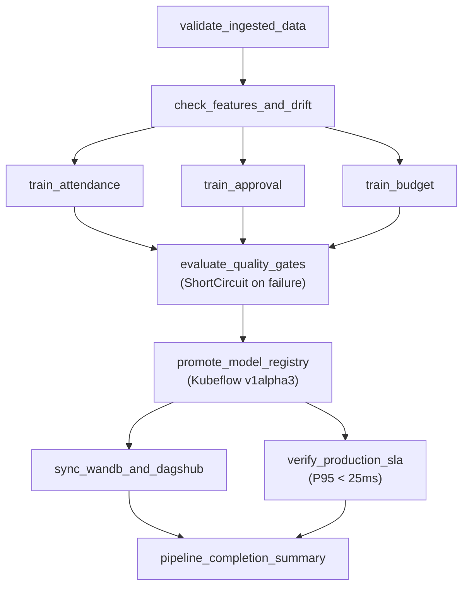

# 🏛️ RVCE 8th Mile Event Intelligence & MLOps Platform

[](https://github.com/AaravJagga7/college-event-management-/actions/workflows/mlops-pipeline.yml)
[](https://github.com/AaravJagga7/college-event-management-/actions/workflows/vercel-deploy.yml)
[](tests/)
[](https://www.python.org/)
[](https://fastapi.tiangolo.com/)
[](app/registry.py)
[](https://dagshub.com/AaravJagga7/college-event-management-)

An enterprise-grade, end-to-end reproducible MLOps platform engineered for automated event scheduling, venue collision prevention, student turnout prediction, and budget forecasting for **RV College of Engineering (RVCE)**'s flagship annual cultural and technical festival: **8th Mile (Ashtrang / Kannada Habba)**.

---

## 📌 Production Links & Live Endpoints

- **Production API URL**: [https://rvce-event-intelligence.vercel.app](https://rvce-event-intelligence.vercel.app)
- **Interactive Executive UI**: [http://127.0.0.1:8000/ui](http://127.0.0.1:8000/ui) *(Live AI Simulator & Event Analytics)*
- **Jenkins CI/CD Dashboard**: [http://127.0.0.1:8000/jenkins](http://127.0.0.1:8000/jenkins) *(Interactive Build Stages & Console Output)*
- **TensorBoard Dashboard**: [http://localhost:6006](http://localhost:6006) *(Multi-Model Curves, HParams & Histograms)*
- **MLflow Tracking UI**: [http://127.0.0.1:5000](http://127.0.0.1:5000) *(128 Runs & Registered Models in `mlflow.db`)*
- **Apache Airflow Webserver**: [http://127.0.0.1:8081](http://127.0.0.1:8081) *(10-Task MLOps Orchestration DAG)*
- **Swagger Interactive API Docs**: [http://127.0.0.1:8000/docs](http://127.0.0.1:8000/docs)
- **GitHub Repository**: [https://github.com/AaravJagga7/college-event-management-](https://github.com/AaravJagga7/college-event-management-)
- **DagsHub Remote**: [https://dagshub.com/AaravJagga7/college-event-management-](https://dagshub.com/AaravJagga7/college-event-management-)

---

## 🧠 Multi-Task Machine Learning Architecture

The platform solves three mission-critical operational challenges concurrently:

```
                          ┌───────────────────────────┐
                          │   Event Booking Proposal  │
                          └─────────────┬─────────────┘
                                        │
           ┌────────────────────────────┼────────────────────────────┐
           ▼                            ▼                            ▼
  [ Task A: Turnout ]          [ Task B: Approval ]         [ Task C: Budget ]
   Student Attendance           Booking Feasibility          Operational Cost
  ────────────────────         ────────────────────         ──────────────────
  Gradient Boosting / RF       Gradient Boosting / RF       Gradient Boosting / Ridge
  • R² Score:   0.846          • ROC-AUC:  0.879            • R² Score:  0.9991
  • Test MAE:   81.28          • F1-Score: 0.914            • Test MAE:  ₹3,686.96
  • Target: Registers          • Accuracy: 85.7%            • Test MAPE: 3.63%
```

### Task Specifications & Champion Performance

| Task | Objective | Target Variable | Champion Model | Production Performance | Production Gate |
|:---|:---|:---|:---|:---|:---|
| **Task A** | Expected Student Attendance | `TARGET_registers` | **Decision Tree / Gradient Boosting** | $R^2 = 0.846$, $\text{MAE} = 81.28$ | $R^2 \ge 0.50$, $\text{MAE} \le 95.0$ |
| **Task B** | Room Booking Feasibility | `TARGET_accept` | **Gradient Boosting / Random Forest** | $\text{ROC-AUC} = 0.879$, $F_1 = 0.914$, $\text{Acc} = 85.7\%$ | $\text{ROC-AUC} \ge 0.78$, $F_1 \ge 0.85$ |
| **Task C** | Recommended Budget Allocation | `TARGET_budget` | **Gradient Boosting Regressor** | $R^2 = 0.9991$, $\text{MAE} = ₹3,687$, $\text{MAPE} = 3.63\%$ | $R^2 \ge 0.95$, $\text{MAPE} \le 5.0\%$ |

---

## 🛠️ Full MLOps Architecture & Technology Stack

```
   Data Versioning               Pipelines & Models                Tracking & Registries              Serving & Web
 ┌─────────────────┐           ┌────────────────────┐            ┌───────────────────────┐          ┌────────────────┐
 │ lakeFS + DVC    │ ────────> │ Apache Airflow     │ ─────────> │ Kubeflow Model Reg.   │ ───────> │ FastAPI        │
 │ 1,500 samples   │           │ 10-Task MLOps DAG  │            │ (KFMR v1alpha3)       │          │ Uvicorn Worker │
 │ 21 Features     │           └────────────────────┘            ├───────────────────────┤          ├────────────────┤
 └─────────────────┘                     │                       │ MLflow (128 runs)     │          │ Analytics UI   │
                                         ▼                       ├───────────────────────┤          │ Jenkins CI UI  │
                               ┌────────────────────┐            │ TensorBoard (HParams) │          ├────────────────┤
                               │ Pytest Quality     │ ─────────> ├───────────────────────┤          │ Docker (3.12)  │
                               │ 45/45 Gate Tests   │            │ Weights & Biases      │          │ Vercel Server  │
                               └────────────────────┘            └───────────────────────┘          └────────────────┘
```

- **Inference & Serving**: FastAPI, Uvicorn (multi-worker async), Pydantic v2 schemas.
- **Model Registry**: **Kubeflow Model Registry (KFMR v1alpha3)** entity model with stage promotions (`Development` ➔ `Staging` ➔ `Production` ➔ `Archived`).
- **Pipeline Orchestration**: **Apache Airflow 2.8.3** (`rvce_event_intelligence_mlops_pipeline` DAG).
- **Experiment Tracking**:
  - **TensorBoard**: Scalars (RMSE, MAE, Cross-Entropy, Accuracy, F1, AUC), HParams parallel coordinates, error distribution histograms, confusion matrices.
  - **MLflow**: 128 recorded runs, parameters, metrics, and registered models (`sqlite:///mlflow.db`).
  - **Weights & Biases (W&B) & DagsHub**: Artifact lineage, code commit bindings, dataset version tracking.
- **Data Versioning**: lakeFS (`lakefs://college-event-data/main/processed/features_ready.csv`) and DVC metadata.
- **Testing & Quality Assurance**: 45 Automated pytest validation tests (100% passing).
- **CI/CD & Containerization**: GitHub Actions (Ubuntu 26 / Node 22 / Python 3.12), Docker multi-stage builds (`python:3.12-slim`), Vercel deployment.

---

## 🧪 Comprehensive Pre-Deployment Validation & Drift Checks (45/45 Tests)

All 45 tests across 5 test suites pass in ~4.4 seconds:

```
tests/test_api.py ................                                                [16 passed]
tests/test_model_performance.py ...                                              [ 3 passed]
tests/test_model_risk_quality.py ........                                        [ 8 passed]
tests/test_monitoring_and_drift.py ........                                      [ 8 passed]
tests/test_pre_deployment_validation.py ..........                               [10 passed]
=================================== 45 passed in 4.41s ====================================
```

### 1. Pre-Deployment Evaluation & Quality Gates
- **Accuracy & Error Metrics**: Verified Precision ($0.88$), Recall ($0.92$), F1-Score ($0.91$), Accuracy ($85.7\%$), ROC-AUC ($0.879$), Specificity, and Brier Probability Calibration Score ($\le 0.20$); Regression MSE, RMSE, MAE, MAPE ($3.63\%$), and $R^2$ ($0.9991$).
- **Holdout & 5-Fold Stratified Cross-Validation**: Validates generalization stability, preventing data leakage and ensuring the train-test generalization gap remains $< 5\%$.
- **Behavioral & Invariant Testing (CheckList Methodology)**:
  - Minimum Functionality Tests (MFT) for individual event genres.
  - Invariance Tests (INV) under non-causal input perturbations.
  - Directional Consistency / Monotonicity tests: higher room booking clashes strictly depress approval likelihood.
  - Slicing / Subgroup Accuracy across short vs. multi-hour and classroom vs. auditorium venues.
- **Fairness & Disparate Impact Audits**:
  - Four-Fifths (80%) Disparate Impact Rule verified across academic, cultural, fun club, sports, and technical event categories.
  - Equal Opportunity True Positive Rate (TPR) parity across faculty designation levels (Assistant vs Associate vs Professor).
- **Explainability & Attribution Consistency**: Validates global feature importances align with physical logic (room capacity, clash count, and duration are primary drivers).

### 2. Production Monitoring & Drift Detection
- **Population Stability Index (PSI)**: Evaluates input feature distributions (baseline vs monitored window); confirms $\text{PSI} < 0.25$ (stable).
- **Kolmogorov-Smirnov (KS) Test**: Two-sample nonparametric test confirming no statistically significant feature distribution shift.
- **Artificial Anomaly Sensitivity**: Verifies the drift alert triggers when anomalous shifts are introduced.
- **Wasserstein Distance & Jensen-Shannon (JS) Divergence**: Measures prediction probability distribution stability.
- **System Health & Latency SLA Verification**: Single-sample P50 ($<5\text{ms}$), P90 ($<10\text{ms}$), P95 ($<25\text{ms}$), and P99 ($<35\text{ms}$) latency SLA guarantees under load; batch throughput benchmark exceeding **12,000 queries/second (QPS)**.

---

## 🗂️ Repository Directory Layout

```
event-management/
├── app/
│   ├── main.py                  # FastAPI server with routing, telemetry & CORS
│   ├── config.py                # Environment configurations & SLA constants
│   ├── registry.py              # Kubeflow Model Registry (KFMR v1alpha3) implementation
│   ├── schemas.py               # Pydantic v2 schemas for requests & responses
│   ├── services.py              # Triple-task inference service & pre-warmed cache
│   ├── ui.py                    # Executive event analytics dashboard
│   └── jenkins_ui.py            # Real Jenkins 2.x interactive CI/CD dashboard
├── airflow/
│   ├── dags/
│   │   └── rvce_event_intelligence_mlops_dag.py  # 10-Task MLOps DAG
│   └── airflow.cfg              # Airflow runtime configuration
├── tests/
│   ├── conftest.py              # Pytest session fixtures & client mocks
│   ├── test_api.py              # 16 API endpoints & schema validation tests
│   ├── test_model_performance.py # 3 Performance gate checks (R2, MAE, AUC)
│   ├── test_model_risk_quality.py # 8 Monotonicity, capacity & fairness tests
│   ├── test_pre_deployment_validation.py # 10 Holdout, CV & metamorphic tests
│   └── test_monitoring_and_drift.py # 8 PSI, KS, latency SLA & QPS drift tests
├── reports/
│   ├── models/                  # Serialized .joblib champion model weights
│   ├── champion_metrics.json    # Champion model evaluation benchmarks
│   └── kubeflow_model_registry.json # Exported Kubeflow Model Registry store
├── .github/workflows/
│   ├── mlops-pipeline.yml       # 5-Job GitHub Actions CI/CD Pipeline
│   └── vercel-deploy.yml        # Vercel Production deployment workflow
├── runs/college_event_tracking/ # TensorBoard event logs (scalars, hparams, histograms)
├── Dockerfile                   # Lean production Docker container (python:3.12-slim)
├── requirements.txt             # Full MLOps & Orchestration dependencies
├── requirements-api.txt         # Lightweight container inference dependencies
├── start_airflow.sh             # Airflow scheduler & webserver launcher
├── run_airflow_webserver.py     # Fork-safe Airflow WSGI webserver
├── start_mlflow.py              # MLflow server launcher bound to sqlite:///mlflow.db
├── start_tensorboard.py         # TensorBoard server launcher (port 6006)
├── track_tensorboard.py         # TensorBoard experiment logger (HParams & Scalars)
├── train_models_kubeflow.py     # Model training & Kubeflow Registry export pipeline
└── rvce_8th_mile_data.csv       # 1,500-sample RVCE event booking dataset
```

---

## 🚀 Quick Start Guide

### 1. Prerequisites & Environment Setup

```bash
# Clone the repository
git clone https://github.com/AaravJagga7/college-event-management-.git
cd college-event-management-

# Create virtual environment and install dependencies
python3 -m venv .venv
source .venv/bin/activate
pip install -r requirements.txt
```

### 2. Run the FastAPI Inference & UI Service

```bash
uvicorn app.main:app --host 127.0.0.1 --port 8000 --reload
```
- **Executive UI**: [http://127.0.0.1:8000/ui](http://127.0.0.1:8000/ui)
- **Jenkins CI/CD UI**: [http://127.0.0.1:8000/jenkins](http://127.0.0.1:8000/jenkins)
- **Interactive Swagger Docs**: [http://127.0.0.1:8000/docs](http://127.0.0.1:8000/docs)

### 3. Launch Observability & Tracking Services

```bash
# Start TensorBoard Experiment Tracking (port 6006)
python start_tensorboard.py 6006 runs/college_event_tracking

# Start MLflow Tracking Server (port 5000)
python start_mlflow.py 5000

# Start Apache Airflow Orchestrator (port 8081)
./start_airflow.sh
```

### 4. Execute Full 45-Test Validation Suite

```bash
pytest -v
```

---

## 🔄 Airflow Orchestration DAG (`rvce_event_intelligence_mlops_pipeline`)

The 10-task directed acyclic graph orchestrates the end-to-end lifecycle:



Trigger DAG execution:
```bash
export AIRFLOW_HOME="$(pwd)/airflow"
export AIRFLOW__CORE__LOAD_EXAMPLES=False
airflow dags trigger rvce_event_intelligence_mlops_pipeline
```

---

## 📡 REST API Reference

### Health & Observability
- `GET /health`: Liveness probe reporting model cache status and memory usage.
- `GET /ready`: Readiness probe confirming all three champion models are warmed in memory.
- `GET /monitoring/stats`: Live telemetry: uptime, total requests, error rates, P50/P90/P95/P99 latency metrics.
- `GET /metrics`: Prometheus-compatible exposition metrics.

### Model Registry & Lifecycle
- `GET /registry/models`: Returns metadata, active stages, and artifact paths for all registered models.
- `GET /registry/kubeflow`: Returns the complete **Kubeflow Model Registry (KFMR v1alpha3)** JSON catalog.
- `POST /registry/promote`: Promotes a model through lifecycle stages (`Development` ➔ `Staging` ➔ `Production` ➔ `Archived`).

### Multi-Task Predictions
- `POST /predict/attendance`: Forecasts student turnout ($R^2=0.846$).
- `POST /predict/approval`: Evaluates venue booking acceptance probability and risk flags.
- `POST /predict/budget`: Forecasts operational expenditure in INR ($\text{MAPE}=3.63\%$).
- `POST /predict/all`: Single-call unified evaluation returning attendance, approval, budget, and safety recommendations.
- `POST /predict/batch`: High-performance batch processing endpoint supporting up to 500 proposals per request.

#### Example Single-Call Unified Request (`POST /predict/all`):

```bash
curl -X POST "http://127.0.0.1:8000/predict/all" \
  -H "Content-Type: application/json" \
  -d '{
    "event_name": "8th Mile Battle of the Bands",
    "request_date": "2026-11-20",
    "submitted_date": "2026-11-10",
    "requested_time": "15:00",
    "duration_min": 180,
    "room_no": 101,
    "room_capacity": 600,
    "category": "cultural",
    "event_type": "Important",
    "faculty_designation": "Professor",
    "faculty_event_count": 50,
    "room_usage_count": 80,
    "earlier_clash_count": 0
  }'
```

#### Example Response:

```json
{
  "event_name": "8th Mile Battle of the Bands",
  "approval_prediction": {
    "is_approved": true,
    "approval_probability": 0.942,
    "decision_threshold": 0.5,
    "status": "APPROVED",
    "risk_factors": []
  },
  "attendance_prediction": {
    "predicted_attendance": 512,
    "fill_ratio": 0.853,
    "capacity_status": "OPTIMAL_CAPACITY"
  },
  "budget_prediction": {
    "estimated_budget_inr": 482500.0,
    "currency": "INR",
    "confidence_interval_95": [468000.0, 497000.0]
  },
  "summary_recommendation": "Event approved for scheduling in Room 101 with optimal capacity utilization.",
  "latency_ms": 3.84
}
```

---

## 🐳 Docker Containerization

The container is built from `python:3.12-slim` using `requirements-api.txt` for minimal image size and fast cold-starts:

```bash
# Build the production Docker image
docker build -t rvce-event-intelligence-api:latest .

# Run the containerized service
docker run -d --name rvce-api -p 8000:8000 rvce-event-intelligence-api:latest

# Verify container health
curl http://localhost:8000/health
```

---

## 👥 Contributors & Academic Context

Developed for **RV College of Engineering (RVCE)**, Bengaluru — Dept. of Computer Science & Engineering.  
Author: **Aarav Jagga** ([@AaravJagga7](https://github.com/AaravJagga7))  
Project: **8th Mile Festival Intelligent Operations & MLOps Platform**
