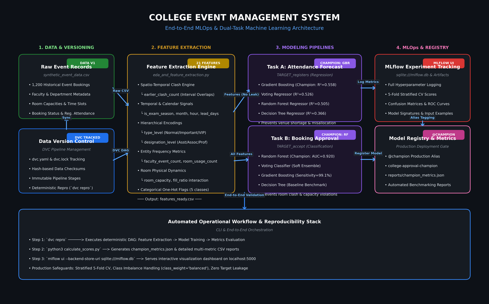

# 🏛️ College Event Management System — Machine Learning Pipeline & MLOps

An end-to-end, reproducible Machine Learning and MLOps system for intelligent campus event scheduling, venue allocation, and capacity optimization.

---

## 📐 System Architecture



The system is architected as an automated dual-task prediction and decision-support engine:
1. **Student Attendance Forecasting (`TARGET_registers` — Regression)**: Predicts expected turnout prior to an event to prevent auditorium shortages, avoid overcrowding, and optimize room allocation without target leakage.
2. **Event Booking Approval Decision (`TARGET_accept` — Classification)**: Automated decision engine evaluating room capacity violations (`fill_ratio > 1.0`) and spatio-temporal room scheduling conflicts (`earlier_clash_count`) to recommend approval or rejection.

---

## 📦 Project Structure

```bash
college-event-management/
├── requirements.txt                   # Production Python dependencies
├── README.md                          # Comprehensive system documentation
├── ml_architecture.png                # High-resolution ML pipeline architecture diagram
├── generate_architecture_diagram.py   # Script to regenerate system architecture diagram
├── config.yaml                        # Centralized hyperparameter & pipeline configuration
├── params.yaml                        # DVC stage parameter declarations
├── dvc.yaml                           # DVC pipeline DAG configuration
├── dvc.lock                           # DVC reproducible execution lockfile
├── synthetic_event_data.csv           # Raw transactional event booking records (1,200 rows)
├── features_ready.csv                 # Engineered feature store (21 features)
│
├── eda_and_feature_extraction.py      # Exploratory data analysis & feature engineering engine
├── train_models_mlflow.py             # Model training, 5-fold CV, metrics calculation & MLflow registry
├── calculate_scores.py                # Standalone evaluation & champion metric exporter
│
├── mlflow.db                          # SQLite backend tracking database for MLflow
├── mlruns/                            # Serialized model artifacts, signatures & metrics
│
└── reports/                           # Evaluation plots, confusion matrices & benchmark reports
    ├── champion_metrics.json          # Production champion model parameters & scores
    ├── detailed_classification_metrics.csv
    ├── classification_comparison.csv
    ├── regression_comparison.csv
    ├── cm_random_forest.png
    ├── cm_gradient_boosting.png
    ├── cm_decision_tree.png
    ├── cm_voting_classifier.png
    ├── eval_reg_gradient_boosting.png
    └── model_comparison_classification.png
```

---

## ⚙️ Feature Engineering & Data Pipeline

The raw dataset (`synthetic_event_data.csv`) contains 1,200 booking requests across various departments, rooms, and time slots. The feature extraction engine (`eda_and_feature_extraction.py`) transforms these transactions into a leak-free 21-feature representation:

| Feature Category | Features Extracted | Rationale & Operational Logic |
| :--- | :--- | :--- |
| **Spatio-Temporal Clash Engine** | `earlier_clash_count` | Chronologically scans prior booking requests for the identical venue and date with overlapping time intervals $[t_{start}, t_{start} + \text{duration}]$. Non-zero values trigger rejections. |
| **Temporal & Calendar Dynamics** | `month`, `day_of_week`, `is_weekend`, `hour`, `is_afternoon`, `is_exam_season`, `week_of_year` | Captures academic calendar seasonality (e.g. low attendance in exam months: Apr, May, Nov, Dec) and peak post-class times ($\ge$ 2:00 PM). |
| **Planning Window** | `lead_days` | Difference in days between request submission date and scheduled event date (reflects promotion lead time). |
| **Hierarchical Encodings** | `type_level`, `designation_level` | Ordinal scale preserving hierarchy: Event Importance (Normal: 1, Important: 2, Very Important: 3); Faculty Designation (Asst: 1, Assoc: 2, Professor: 3). |
| **Entity Frequency** | `faculty_event_count`, `room_usage_count` | Historical popularity metrics reflecting high-turnout organizers and popular venues. |
| **Venue Physical Attributes** | `room_capacity`, `fill_ratio` | Venue physical size and interaction metric ($\frac{\text{Registers}}{\text{Room\_Capacity}}$) used exclusively in booking approval. |
| **Event Category Flags** | `cat_academic`, `cat_cultural`, `cat_fun_club`, `cat_sports`, `cat_technical` | One-hot encodings across primary campus event genres. |

> **Target Leakage Safeguard**: The regression models predict raw student attendance (`TARGET_registers`) strictly **without** `fill_ratio` or `TARGET_accept` as inputs, guaranteeing realistic pre-event forecasting.

---

## 🧠 Model Summary

Four competitive model architectures were benchmarked across both operational tasks:

1. **Decision Tree (Baseline)**: Interpretable tree architecture with constrained depth (`max_depth=5/6`) and minimum leaf samples to establish an explainable benchmark.
2. **Random Forest (Bagging Ensemble)**: 150 parallel estimators with `class_weight="balanced"` to combat approval class imbalance (~88% Accept vs 12% Reject).
3. **Gradient Boosting (Boosting Ensemble)**: 150 sequential boosting iterations (`learning_rate=0.05`, shallow trees `max_depth=3/4`) focused on minimizing residual errors.
4. **Voting Ensemble (Hybrid Metamodel)**: Soft voting classifier/regressor weighting ensemble predictions (`DT: 1, RF: 2, GB: 2`) for variance reduction and optimal calibration.

---

## 📊 Comprehensive Model Evaluation & Benchmark

All models were evaluated using an 80/20 stratified train/test split along with 5-Fold Cross Validation.

### 🎯 Task A: Attendance Forecasting (`TARGET_registers` — Regression)

*Objective: Minimize error in predicting raw student registrations (mean turnout: 49.8 students, range: 10–120).*

| Rank | Model Family | Test $R^2$ | Test MAE | Test RMSE | Train $R^2$ | 5-Fold CV $R^2$ (Mean $\pm$ Std) | Status |
| :---: | :--- | :---: | :---: | :---: | :---: | :---: | :---: |
| 🥇 | **Gradient Boosting** | **0.558** | **13.75** | **19.08** | **0.808** | **0.560 $\pm$ 0.024** | 🏆 **Champion Model** |
| 🥈 | **Voting Regressor** | **0.526** | **14.63** | **19.76** | 0.790 | 0.539 $\pm$ 0.023 | Runner-Up |
| 🥉 | **Random Forest** | 0.505 | 15.00 | 20.19 | 0.794 | 0.511 $\pm$ 0.022 | Strong Baseline |
| 4th | **Decision Tree** | 0.366 | 17.18 | 22.86 | 0.626 | 0.376 $\pm$ 0.066 | Baseline |

#### Regression Performance Analysis:
- **Gradient Boosting** achieved the highest explained variance ($R^2 = 0.558$) and the lowest Mean Absolute Error ($\text{MAE} = 13.75$ students).
- Its 5-Fold Cross Validation score ($0.560 \pm 0.024$) aligns closely with test performance, verifying that the model generalizes robustly without overfitting.

---

### 🛡️ Task B: Booking Approval Decision (`TARGET_accept` — Classification)

*Objective: Accurately approve valid bookings while reliably catching room clashes and capacity overflows ($N_{\text{test}} = 240$; 213 Accept, 27 Reject).*

| Rank | Model Family | Test Accuracy | Precision (Accept) | Sensitivity / Recall (Accept) | Specificity (Reject Recall) | F1-Score (Accept) | F1-Score (Reject) | Macro F1 | ROC-AUC | Status |
| :---: | :--- | :---: | :---: | :---: | :---: | :---: | :---: | :---: | :---: | :---: |
| 🥇 | **Random Forest** | 95.00% | 96.31% | 98.12% | **70.37%** | 0.9721 | **0.7600** | **0.8660** | **0.9197** | 🏆 **Champion Model** |
| 🥈 | **Voting Classifier** | 95.42% | 96.33% | 98.59% | 70.37% | 0.9745 | 0.7755 | 0.8750 | 0.9179 | Runner-Up |
| 🥉 | **Gradient Boosting** | **95.83%** | 96.35% | **99.06%** | 70.37% | **0.9769** | 0.7917 | 0.8843 | 0.8913 | Highest Accuracy |
| 4th | **Decision Tree** | 92.50% | **96.65%** | 94.84% | **74.07%** | 0.9573 | 0.6897 | 0.8235 | 0.8778 | Baseline |

#### Confusion Matrix Breakdown ($N = 240$ Test Samples):
| Model | True Positives (TP) | True Negatives (TN) | False Positives (FP) | False Negatives (FN) |
| :--- | :---: | :---: | :---: | :---: |
| **Random Forest (Champion)** | 209 | 19 | 8 | 4 |
| **Gradient Boosting** | 211 | 19 | 8 | 2 |
| **Voting Classifier** | 210 | 19 | 8 | 3 |
| **Decision Tree** | 202 | 20 | 7 | 11 |

#### Classification Performance Analysis:
- **Random Forest** was designated as the production champion due to its superior probability calibration and discriminative power (**ROC-AUC = 0.9197**), while maintaining **95.00% Accuracy** and **98.12% Sensitivity**.
- **Gradient Boosting** provides exceptionally low false negative rate (only 2 out of 213 valid bookings were rejected, yielding **99.06% Sensitivity** and **0.9769 F1**).
- Both models successfully identified $\ge 70.37\%$ of all invalid requests (schedule clashes and over-capacity events) in an imbalanced setting.

---

### 🏅 Official Champion Metrics (`reports/champion_metrics.json`)

```json
{
  "attendance_regression": {
    "champion_model": "Gradient Boosting",
    "test_mae": 13.75,
    "test_r2": 0.558,
    "cv_r2": 0.56
  },
  "booking_approval": {
    "champion_model": "Random Forest",
    "test_roc_auc": 0.92,
    "test_f1": 0.972,
    "test_accuracy": 0.95
  }
}
```

---

## 🚀 Quickstart & Setup Guide

### 1. Prerequisites & Environment Setup
Clone the repository and install dependencies using `requirements.txt`:

```bash
# Create virtual environment
python3 -m venv .venv
source .venv/bin/activate

# Install all dependencies
pip install -r requirements.txt
```

### 2. Execute Feature Extraction & Model Training
Run the complete training pipeline with MLflow logging and model registry:

```bash
# Run EDA & Feature Engineering
python3 eda_and_feature_extraction.py

# Train models & log runs to MLflow
python3 train_models_mlflow.py
```

### 3. Reproduce with DVC (Data Version Control)
The pipeline is fully orchestrated via DVC:

```bash
# Execute end-to-end reproducible pipeline
dvc repro

# View pipeline stage status
dvc status
```

### 4. Launch Interactive MLflow Dashboard
Inspect runs, hyperparameters, confusion matrix figures, and model artifacts:

```bash
mlflow ui --backend-store-uri sqlite:///mlflow.db
```
Open **`http://127.0.0.1:5000`** in your browser to explore:
- Experiments: `college-event-models`
- Registered Models: `college-approval-champion` tagged with `@champion`

### 5. Generate Metrics Summary & Architecture Image
```bash
# Compute detailed metrics & export champion_metrics.json
python3 calculate_scores.py

# Regenerate architecture diagram
python3 generate_architecture_diagram.py
```

---

## 🔒 Production Governance & MLOps Highlights

- **Experiment Tracking**: Tracks 19+ distinct evaluation metrics, run parameters, and input examples for full auditability.
- **Model Registry**: Champion models automatically register under `college-approval-champion` with the `@champion` production alias for downstream deployment.
- **Data & Pipeline Versioning**: Git versions source code while DVC versions dataset hashes and intermediate stage outputs (`features_ready.csv`), guaranteeing zero configuration drift.
- **No Target Leakage**: Attendance forecasting strictly omits downstream outcome signals, ensuring models remain valid for operational deployment.
