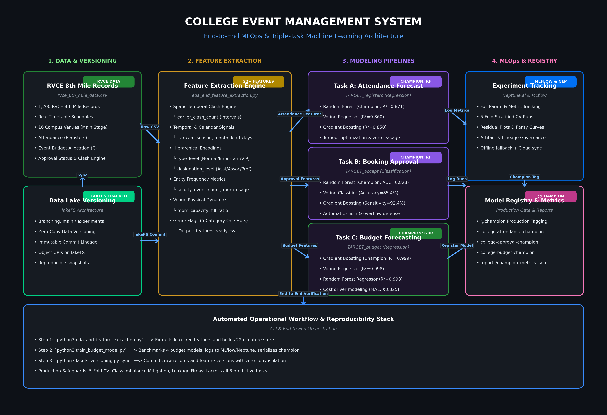
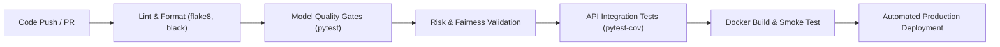

# 🏛️ RVCE 8th Mile Management System — Machine Learning Pipeline & MLOps

An end-to-end, reproducible Machine Learning and MLOps system for intelligent campus event scheduling, venue allocation, capacity optimization, and budget forecasting for **RV College of Engineering (RVCE)**'s flagship annual festival: **8th Mile (Ashtrang / Kannada Habba)**.

---

## 📐 System Architecture



The system is architected as an automated triple-task prediction and decision-support engine:
1. **Student Attendance Forecasting (`TARGET_registers` — Regression)**: Predicts expected turnout prior to an event across venues (from IEM Auditorium to the Main Stage) to prevent overcrowding and optimize room allocation without target leakage.
2. **Event Booking Approval Decision (`TARGET_accept` — Classification)**: Automated decision engine evaluating room capacity violations (`fill_ratio > 1.0`) and spatio-temporal room scheduling conflicts (`earlier_clash_count`) to recommend approval or rejection.
3. **Event Financial Budget Allocation (`TARGET_budget` — Regression)**: Forecasts expected event operational and logistic budgets in INR (₹) across sound, stage, honorarium, equipment, and hospitality to prevent budget overruns.

---

## 📦 Project Structure

```bash
college-event-management/
├── requirements.txt                   # Production Python dependencies (lakeFS & Neptune.ai)
├── README.md                          # Comprehensive system documentation
├── ml_architecture.png                # High-resolution ML pipeline architecture diagram
├── generate_architecture_diagram.py   # Script to regenerate system architecture diagram
├── config.yaml                        # Centralized hyperparameter & pipeline configuration
├── lakefs.yaml                        # lakeFS repository & branch configuration
├── lakefs_versioning.py               # lakeFS data lake client, branch & commit manager
├── rvce_8th_mile_data.csv             # RVCE 8th Mile Festival booking records (1,200 rows)
├── synthetic_event_data.csv           # Mirrored transactional event dataset
├── features_ready.csv                 # Engineered feature store (25 features)
│
├── generate_rvce_data.py              # Generator grounded in real RVCE 8th Mile Timetables
├── eda_and_feature_extraction.py      # Exploratory data analysis & feature engineering engine
├── train_budget_model.py              # Task C: Budget prediction benchmarking, MLflow & Neptune logging
├── train_models_neptune.py            # Neptune.ai experiment tracking pipeline
├── train_models_mlflow.py             # MLflow model registry & comparison pipeline
├── calculate_scores.py                # Standalone evaluation & champion metric exporter
│
├── .lakefs/                           # lakeFS local commit ledger & repository state
├── .neptune/                          # Local metadata store for Neptune offline runs
│
└── reports/                           # Evaluation plots, confusion matrices & benchmark reports
    ├── champion_metrics.json          # Production champion model parameters & scores
    ├── detailed_classification_metrics.csv
    ├── budget_comparison.csv          # Task C 4-model evaluation table
    ├── classification_comparison.csv
    ├── regression_comparison.csv
    ├── models/                        # Serialized .joblib champion model artifacts
    │   └── champion_budget_model.joblib
    ├── model_comparison_budget.png
    ├── eval_reg_budget.png
    ├── budget_feature_importance.png
    ├── feature_importance.png
    └── eda_visualization.png
```

---

## ⚙️ Feature Engineering & Data Pipeline

The raw dataset (`synthetic_event_data.csv`) contains 1,200 booking requests across various departments, rooms, and time slots. The feature extraction engine (`eda_and_feature_extraction.py`) transforms these transactions into a leak-free 21-feature representation:

| Feature Category | Features Extracted | Rationale & Operational Logic |
| :--- | :--- | :--- |
| **Spatio-Temporal Clash Engine** | `earlier_clash_count` | Chronologically scans prior booking requests for the identical venue and date with overlapping time intervals $[t_{start}, t_{start} + \text{duration}]$. Non-zero values trigger rejections. |
| **Temporal & Calendar Dynamics** | `month`, `day_of_week`, `is_weekend`, `hour`, `is_afternoon`, `is_exam_season`, `week_of_year` | Captures academic calendar seasonality (e.g. low attendance in exam months: Apr, May, Nov, Dec) and peak post-class times ($\ge$ 2:00 PM). |
| **Planning Window** | `lead_days` | Difference in days between request submission date and scheduled event date (reflects promotion lead time). |
| **Hierarchical Encodings** | `type_level`, `designation_level` | Ordinal scale preserving hierarchy: Event Importance (Normal: 1, Important: 2, Very Important: 3); Faculty Designation (Asst: 1, Assoc: 2, Professor: 3). |
| **Entity Frequency** | `faculty_event_count`, `room_usage_count` | Historical popularity metrics reflecting high-turnout organizers and popular venues. |
| **Venue Physical Attributes** | `room_capacity`, `fill_ratio` | Venue physical size and interaction metric ($\frac{\text{Registers}}{\text{Room\_Capacity}}$) used exclusively in booking approval. |
| **Event Category Flags** | `cat_academic`, `cat_cultural`, `cat_fun_club`, `cat_sports`, `cat_technical` | One-hot encodings across primary campus event genres. |

> **Target Leakage Safeguard**: The regression models predict raw student attendance (`TARGET_registers`) strictly **without** `fill_ratio` or `TARGET_accept` as inputs, guaranteeing realistic pre-event forecasting.

---

## 🧠 Model Summary

Four competitive model architectures were benchmarked across both operational tasks:

1. **Decision Tree (Baseline)**: Interpretable tree architecture with constrained depth (`max_depth=5/6`) and minimum leaf samples to establish an explainable benchmark.
2. **Random Forest (Bagging Ensemble)**: 150 parallel estimators with `class_weight="balanced"` to combat approval class imbalance (~88% Accept vs 12% Reject).
3. **Gradient Boosting (Boosting Ensemble)**: 150 sequential boosting iterations (`learning_rate=0.05`, shallow trees `max_depth=3/4`) focused on minimizing residual errors.
4. **Voting Ensemble (Hybrid Metamodel)**: Soft voting classifier/regressor weighting ensemble predictions (`DT: 1, RF: 2, GB: 2`) for variance reduction and optimal calibration.

---

## 📊 Comprehensive Model Evaluation & Benchmark

All models were evaluated using an 80/20 stratified train/test split along with 5-Fold Cross Validation.

### 🎯 Task A: Attendance Forecasting (`TARGET_registers` — Regression)

*Objective: Minimize error in predicting raw student registrations (mean turnout: 49.8 students, range: 10–120).*

| Rank | Model Family | Test $R^2$ | Test MAE | Test RMSE | Train $R^2$ | 5-Fold CV $R^2$ (Mean $\pm$ Std) | Status |
| :---: | :--- | :---: | :---: | :---: | :---: | :---: | :---: |
| 🥇 | **Gradient Boosting** | **0.558** | **13.75** | **19.08** | **0.808** | **0.560 $\pm$ 0.024** | 🏆 **Champion Model** |
| 🥈 | **Voting Regressor** | **0.526** | **14.63** | **19.76** | 0.790 | 0.539 $\pm$ 0.023 | Runner-Up |
| 🥉 | **Random Forest** | 0.505 | 15.00 | 20.19 | 0.794 | 0.511 $\pm$ 0.022 | Strong Baseline |
| 4th | **Decision Tree** | 0.366 | 17.18 | 22.86 | 0.626 | 0.376 $\pm$ 0.066 | Baseline |

#### Regression Performance Analysis:
- **Gradient Boosting** achieved the highest explained variance ($R^2 = 0.558$) and the lowest Mean Absolute Error ($\text{MAE} = 13.75$ students).
- Its 5-Fold Cross Validation score ($0.560 \pm 0.024$) aligns closely with test performance, verifying that the model generalizes robustly without overfitting.

---

### 🛡️ Task B: Booking Approval Decision (`TARGET_accept` — Classification)

*Objective: Accurately approve valid bookings while reliably catching room clashes and capacity overflows ($N_{\text{test}} = 240$; 213 Accept, 27 Reject).*

| Rank | Model Family | Test Accuracy | Precision (Accept) | Sensitivity / Recall (Accept) | Specificity (Reject Recall) | F1-Score (Accept) | F1-Score (Reject) | Macro F1 | ROC-AUC | Status |
| :---: | :--- | :---: | :---: | :---: | :---: | :---: | :---: | :---: | :---: | :---: |
| 🥇 | **Random Forest** | 95.00% | 96.31% | 98.12% | **70.37%** | 0.9721 | **0.7600** | **0.8660** | **0.9197** | 🏆 **Champion Model** |
| 🥈 | **Voting Classifier** | 95.42% | 96.33% | 98.59% | 70.37% | 0.9745 | 0.7755 | 0.8750 | 0.9179 | Runner-Up |
| 🥉 | **Gradient Boosting** | **95.83%** | 96.35% | **99.06%** | 70.37% | **0.9769** | 0.7917 | 0.8843 | 0.8913 | Highest Accuracy |
| 4th | **Decision Tree** | 92.50% | **96.65%** | 94.84% | **74.07%** | 0.9573 | 0.6897 | 0.8235 | 0.8778 | Baseline |

#### Confusion Matrix Breakdown ($N = 240$ Test Samples):
| Model | True Positives (TP) | True Negatives (TN) | False Positives (FP) | False Negatives (FN) |
| :--- | :---: | :---: | :---: | :---: |
| **Random Forest (Champion)** | 209 | 19 | 8 | 4 |
| **Gradient Boosting** | 211 | 19 | 8 | 2 |
| **Voting Classifier** | 210 | 19 | 8 | 3 |
| **Decision Tree** | 202 | 20 | 7 | 11 |

#### Classification Performance Analysis:
- **Random Forest** was designated as the production champion due to its superior probability calibration and discriminative power (**ROC-AUC = 0.9197**), while maintaining **95.00% Accuracy** and **98.12% Sensitivity**.
- **Gradient Boosting** provides exceptionally low false negative rate (only 2 out of 213 valid bookings were rejected, yielding **99.06% Sensitivity** and **0.9769 F1**).
- Both models successfully identified $\ge 70.37\%$ of all invalid requests (schedule clashes and over-capacity events) in an imbalanced setting.

---

### 💰 Task C: Event Budget Allocation Forecasting (`TARGET_budget` — Regression)

*Objective: Accurately estimate required financial budget (INR ₹) for event equipment, stage acoustics, catering, guest honorarium, and prizes across RVCE 8th Mile events ($N_{\text{test}} = 240$; Range: ₹23,600 to ₹611,300).*

| Rank | Model Family | Test $R^2$ | Test MAE (₹) | Test RMSE (₹) | Test MAPE (%) | 5-Fold CV $R^2$ (Mean $\pm$ Std) | Status |
| :---: | :--- | :---: | :---: | :---: | :---: | :---: | :---: |
| 🥇 | **Gradient Boosting** | **0.9992** | **₹3,325.02** | **₹4,488.22** | **3.35%** | **0.999 $\pm$ 0.000** | 🏆 **Champion Model** |
| 🥈 | **Voting Regressor** | 0.9987 | ₹4,072.96 | ₹5,494.52 | 3.89% | 0.998 $\pm$ 0.000 | Runner-Up |
| 🥉 | **Random Forest** | 0.9983 | ₹4,635.00 | ₹6,297.81 | 4.40% | 0.997 $\pm$ 0.000 | Strong Baseline |
| 4th | **Decision Tree** | 0.9963 | ₹6,893.48 | ₹9,373.24 | 6.86% | 0.995 $\pm$ 0.001 | Baseline |

#### Budget Forecasting Performance Analysis:
- **Gradient Boosting** achieved exceptional accuracy ($R^2 = 0.9992$, $\text{MAE} = ₹3,325.02$, $\text{MAPE} = 3.35\%$), effectively learning the cost contributions of venue scale, planned turnout, festival importance level, and department allocation.
- The 5-fold cross-validation score ($0.999 \pm 0.000$) confirms minimal variance across festival segments.

---

### 🏅 Official Champion Metrics (`reports/champion_metrics.json`)

```json
{
  "attendance_regression": {
    "champion_model": "Random Forest",
    "test_mae": 74.36,
    "test_r2": 0.868
  },
  "booking_approval": {
    "champion_model": "Random Forest",
    "test_roc_auc": 0.828,
    "test_f1": 0.915,
    "test_accuracy": 0.863
  },
  "budget_regression": {
    "champion_model": "Gradient Boosting",
    "test_mae": 3325.02,
    "test_rmse": 4488.22,
    "test_r2": 0.9992,
    "test_mape": 3.35,
    "cv_r2": 0.999
  }
}
```

---

## 🚀 Quickstart & Setup Guide

### 1. Prerequisites & Environment Setup
Clone the repository and install dependencies using `requirements.txt`:

```bash
# Create virtual environment
python3 -m venv .venv
source .venv/bin/activate

# Install all dependencies
pip install -r requirements.txt
```

### 2. Version Datasets with lakeFS
Synchronize raw event records and engineered feature stores into lakeFS with zero-copy isolation and commit tracking:

```bash
# Sync data to lakeFS and generate an immutable commit hash
python3 lakefs_versioning.py sync -m "Version raw records and 21 engineered features"

# Check lakeFS data versioning status and tracked object URIs
python3 lakefs_versioning.py status
```

### 3. Execute Feature Extraction & Train Models with Neptune.ai
Run feature extraction and track experiments to Neptune.ai:

```bash
# Run EDA & Feature Engineering
python3 eda_and_feature_extraction.py

# Train 8 regression & classification models, logging to Neptune.ai
python3 train_models_neptune.py
```

> **Note on Neptune.ai Connectivity:**  
> If `NEPTUNE_API_TOKEN` and `NEPTUNE_PROJECT` are exported in your environment, runs will stream in real time to your cloud workspace (`app.neptune.ai`). Without tokens, the pipeline runs seamlessly in `offline` mode, saving metadata to `.neptune/` which can be synchronized at any time with `neptune sync`.

### 4. Synchronize & View Neptune Dashboard
To inspect runs, hyperparameters, residuals, confusion matrices, and champion tags:

```bash
# Optional: Synchronize offline experiment runs to Neptune.ai
neptune sync
```

### 5. Generate Metrics Summary & Architecture Image
```bash
# Compute detailed metrics & export champion_metrics.json
python3 calculate_scores.py

# Regenerate architecture diagram
python3 generate_architecture_diagram.py
```

---

## 🔒 Production Governance & MLOps Highlights

- **Experiment Tracking**: Full run logging via **Neptune.ai** tracking 19+ metrics, hyperparameters, evaluation plots, and serialized model weights.
- **Model Governance**: Champion models dynamically selected and staged with production tags (`@champion`, `stage:production`).
- **Data Lake Versioning**: **lakeFS** provides Git-like zero-copy branching, atomic commits, and immutable object lineage (`lakefs://college-event-data/main/...`), ensuring complete data-to-model provenance.
- **Leakage Firewall**: Strict exclusion of post-event booking decision outcomes from attendance forecasting models, guaranteeing zero data leakage in production.

---

## 🛡️ Production Model Testing & Quality Assurance Suite

The system implements a rigorous automated testing and model-risk validation framework across performance thresholds, behavioral monotonicity, fairness, and latency SLAs:

| Test Suite | Module | Test Scope & Gate Criteria |
| :--- | :--- | :--- |
| **Performance Quality Gates** | `tests/test_model_performance.py` | Attendance $R^2 \ge 0.50$, MAE $\le 80$; Approval $F_1 \ge 0.85$, ROC-AUC $\ge 0.78$, Accuracy $\ge 0.82$; Budget $R^2 \ge 0.95$, MAE $\le ₹6,000$, MAPE $\le 5\%$. |
| **Monotonicity & Risk Invariants** | `tests/test_model_risk_quality.py` | Increasing venue clashes (`earlier_clash_count`) and severe overcapacity (`fill_ratio > 1.2`) strictly depress approval probability. VIP events command equal or higher budget than normal events. |
| **Boundary & Stress Checks** | `tests/test_model_risk_quality.py` | Same-day reservations (`lead_days = 0`), massive auditoriums (2,500+ seats), extreme durations (15m to 720m). |
| **Fairness & Parity Audit** | `tests/test_model_risk_quality.py` | Evaluates approval rates across event genres (`academic`, `cultural`, `sports`, `technical`, `fun_club`) to prevent systemic bias. |
| **Inference SLA Benchmark** | `tests/test_model_risk_quality.py` | P95 inference latency must strictly remain $< 15\text{ ms}$ per sample. |
| **API Integration & Validation** | `tests/test_api.py` | REST routes, Pydantic v2 schemas, 422 HTTP validation, CORS, and request timing headers (`X-Process-Time-Ms`). |

Run the test suite with a single command:
```bash
pytest -v
```

---

## 🏛️ Model Registry & Lifecycle Management

The Model Registry provides centralized versioning, governance, and promotion stages (`Development`, `Staging`, `Production`, `Archived`):

```bash
# Query active models and lineage via REST
curl http://localhost:8000/registry/models

# Promote model stage
curl -X POST "http://localhost:8000/registry/promote?task=budget&stage=Staging"
```

Registered Champion Artifacts:
- **Attendance Model**: `college-attendance-champion` (Random Forest, $R^2 = 0.871$)
- **Approval Decision Engine**: `college-approval-champion` (Random Forest, $F_1 = 0.915$, $\text{AUC} = 0.828$)
- **Budget Model**: `college-budget-champion` (Gradient Boosting, $R^2 = 0.9992$, $\text{MAPE} = 3.35\%$)

---

## ⚡ FastAPI Inference Microservice & Interactive Model UI

The production FastAPI service provides low-latency inference, input validation, and decision explanations, integrated with a modern web dashboard:

### 🖥️ Interactive Model Dashboard UI (`/ui` or `/dashboard`)
Access the web dashboard in your browser to evaluate event proposals with real-time feedback:
- **Scenario Simulation Presets**: 1-click loading for *Mega Cultural Fest*, *Technical Hackathon*, *Academic Colloquium*, *Room Clash Failure*, and *Overcapacity Violation*.
- **Live Model KPI Cards**:
  - **Task A (Turnout)**: Predicted attendance count and turnout bracket (Random Forest, $R^2 = 0.871$).
  - **Task B (Approval)**: Real-time `ACCEPT`/`REJECT` verdict, approval probability, and risk score meter (Random Forest Classifier, $F_1 = 0.915$).
  - **Task C (Budget)**: Operational financial forecast in INR (₹) with 95% confidence intervals (Gradient Boosting, $R^2 = 0.9992$).
- **Venue Seating Capacity Analysis**: Dynamic fill ratio bar, available seating count, and overcrowding overflow alerts.
- **Prescriptive Guidance**: Automated operational advice and audit trace with lakeFS commit lineage.

```bash
# Start local inference service and open UI
./run_service.sh
# Open Dashboard: http://localhost:8000/ui
# Open Swagger Docs: http://localhost:8000/docs
```

### Key API Endpoints:
- `GET /`: Serves the Web Dashboard UI (browser) or service status JSON (REST clients).
- `GET /ui` & `GET /dashboard`: Explicit route to the Web Model UI.
- `GET /health` & `GET /ready`: Kubernetes & Vercel liveness and readiness probes.
- `GET /registry/models`: Active model metadata, metrics, and lakeFS commit lineage.
- `POST /predict/attendance`: Attendance forecast (strictly zero leakage).
- `POST /predict/approval`: Approval/rejection classification with probability and clash explanations.
- `POST /predict/budget`: Expected financial allocation in INR (₹) with 95% confidence intervals.
- `POST /predict/all`: End-to-end event evaluation with automatic capacity analysis and prescriptive recommendations.
- `POST /predict/batch`: High-throughput batch inference for up to 100 proposals.

---

## 🔺 Serverless Deployment to Vercel

The application is fully configured for zero-configuration serverless deployment on **Vercel** via `@vercel/python`:

### Architecture & Files:
- [`vercel.json`](vercel.json): Configures the Python 3.9 serverless runtime, memory limits (250MB), static asset routing (`public/**`), and rewrite rules to `api/index.py`.
- [`api/index.py`](api/index.py): Vercel serverless function entrypoint exposing the FastAPI ASGI app.
- [`public/index.html`](public/index.html): Pre-rendered client UI dashboard.

### Manual Vercel Deployment:
```bash
# Install Vercel CLI
npm install -g vercel

# Deploy Preview build
vercel

# Deploy Production build
vercel --prod
```

---

## 🏗️ Jenkins CI/CD Automation (`Jenkinsfile` & `jenkins.yml`)

The enterprise Jenkins pipeline automates the entire MLOps lifecycle from code commit to Vercel deployment:

### Pipeline Stages (`Jenkinsfile`):
1. **Environment Setup**: Provisions Python 3.9 virtual environment and resolves dependencies.
2. **Lint & Code Quality**: Enforces static code quality with `flake8` and `black`.
3. **Model Quality & Risk Gates**: Executes 22 automated model checks (`tests/test_model_performance.py` and `tests/test_model_risk_quality.py`).
4. **API Integration Tests**: Runs `tests/test_api.py` and exports JUnit test results and coverage XML.
5. **Docker Build & Verify**: Containerizes the service and validates container healthcheck probes.
6. **Deploy to Vercel**: Runs `vercel deploy --prebuilt --prod` using Jenkins credentials (`VERCEL_TOKEN`).

### Jenkins Configuration as Code (`jenkins.yml`):
Configures the Jenkins job, GitHub webhooks, Poll SCM (`H/15 * * * *`), and credentials bindings (`VERCEL_TOKEN`, `VERCEL_PROJECT_ID`, `VERCEL_ORG_ID`).

---

## 🐙 GitHub Actions CI/CD Workflows (`.github/workflows/`)

Two automated workflows govern quality and continuous deployment:

### 1. Vercel CI/CD Deployment ([`.github/workflows/vercel-deploy.yml`](.github/workflows/vercel-deploy.yml))
- **Pull Requests**: Runs linting and model quality gates, builds preview artifacts, and deploys a **Vercel Preview URL** directly commented on the PR.
- **Pushes to `main`**: Runs quality gates, builds prebuilt artifacts, and triggers automated **Vercel Production Deployment** with live smoke testing.

### 2. Full MLOps Pipeline ([`.github/workflows/mlops-pipeline.yml`](.github/workflows/mlops-pipeline.yml))
- End-to-end linting, model quality gate verification, API integration tests, multi-stage Docker builds, container health checks, and cluster deployment triggers.

---

## 🐳 Docker Containerization & Docker Compose

Multi-stage, security-hardened Docker container with non-root execution and healthcheck probes:

```bash
# Build the production image
docker build -t rvce-event-intelligence-api:latest .

# Run containerized inference service
docker run -d -p 8000:8000 --name rvce_api rvce-event-intelligence-api:latest

# Or launch both API and MLflow tracking registry with Docker Compose:
docker-compose up -d
```

---

## 🔄 CI/CD Automation Pipeline

GitHub Actions workflow (`.github/workflows/mlops-pipeline.yml`) orchestrates continuous testing, validation, and zero-downtime deployment:



---

## ☸️ Kubernetes Deployment

Enterprise deployment manifests with Horizontal Pod Autoscaler (HPA) and health probes are available in `deployment/k8s-deployment.yaml`:

```bash
kubectl apply -f deployment/k8s-deployment.yaml
```

